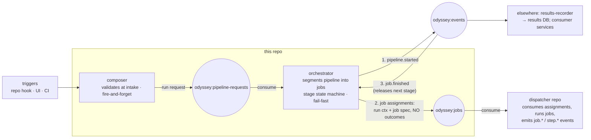

# odyssey-core-orchestrator

The cluster-side orchestrator for the Odyssey CI/CD platform: it turns pipeline triggers into job assignments and owns the stage state machine.

Not a fork of the execution engine — this repo contains no runner management and executes nothing. It composes two services:

- **composer** — intake: consumes origin triggers (repo hook, UI, CI), validates the pipeline configuration at the door, publishes run requests onto the pipeline queue. Fire-and-forget.
- **orchestrator** — consumes run requests, segments the pipeline into jobs, publishes assignments to the job queue, and consumes `job.finished` events to sequence stages (fail-fast: the first Failed or Errored stage ends the run) and emit `pipeline.*` lifecycle events.

The execution side lives in the **dispatcher** repo (`odyssey-ci-cd-platform/dispatcher`): it consumes the job queue, spawns ephemeral runner containers (one job each), and emits `job.*`/`step.*` events. This README scopes to this repo; everything outside it (triggers, dispatcher, results-recorder, consumer services) appears only as a boundary.

## Architecture

### Reading notes

- The numbered ordering on the orchestrator's edges is load-bearing: `pipeline.started` is emitted **before** jobs are published, so the results DB's parent-row invariant holds across distributed producers.
- Assignments carry run context + job spec, **never outcome blobs** — the results DB is the single source of truth for outcomes. It is written by the results-recorder, whose binary is built in the dispatcher repo.
- The orchestrator is the one stateful component in the platform (the price of job-grain). v1: a restart loses in-flight runs (ADR 0001); v2: reconciliation rebuilds state from the results DB.
- No registry and no queue-to-queue dispatcher service are built here: the consumer group is the dispatcher, and capacity gating, claim renewal, and release-on-death are dispatcher-repo mechanics — the contract records the boundary semantics only.

## Vocabulary

| Name | Thing |
|---|---|
| composer | intake service in this repo: validate triggers, publish run requests |
| orchestrator | segmentation + stage state machine in this repo |
| dispatcher | node daemon in the dispatcher repo: consume assignments, manage runners |
| runner | ephemeral docker container executing exactly one job |
| event bus | `odyssey:events` Redis Stream — the only outcome channel |
| results DB | embedded SQLite, one central writer, the queryable system of record |

## Non-goals

- No runner management, container handling, or execution — see the dispatcher repo.
- No per-test analytics, visualization, or notification — consumer services' territory.
- No priorities, quotas, dedup, or commit-status push — deferred until the pipeline above works end to end (one issue each when queued).

## Documents

- [ADR 0001: cluster orchestration](docs/adr/0001-cluster-orchestration.md)
- [Dispatcher contract](docs/contracts/dispatcher-contract.md) — the message schemas binding this repo to the dispatcher repo
- Design discussion: odyssey-ci-cd-platform/dispatcher issue 35
